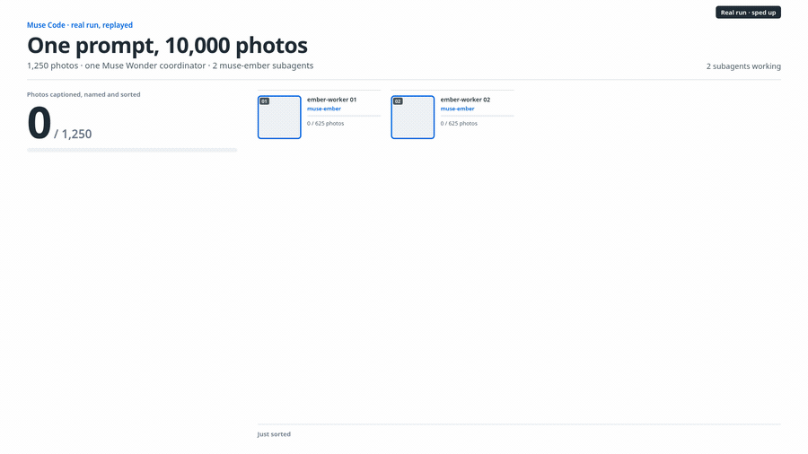
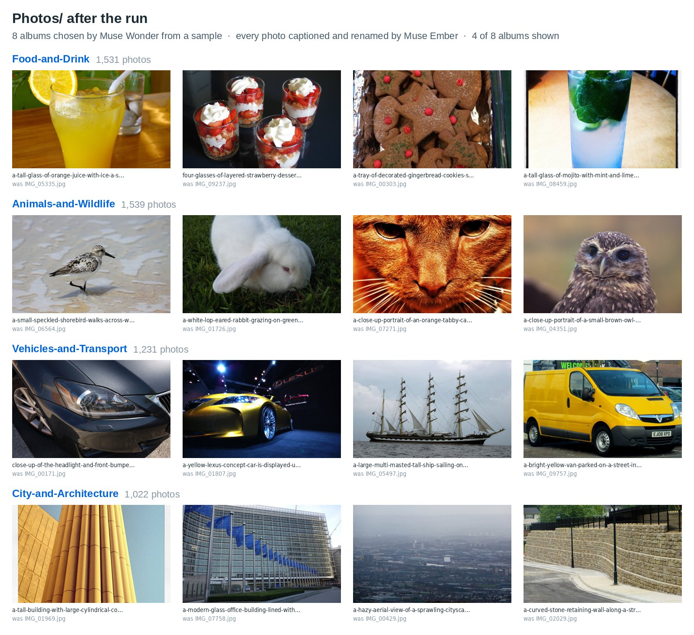

# Organizing images with subagents

|  |  |
|---|---|
| **Section** | [Muse Ember](../README.md) |
| **Time to complete** | ~15 min, plus a few minutes to download the photos |
| **Model** | `muse-wonder-1.0` plans and writes the pipeline; `muse-ember-1.0` runs the 16 workers and every photo request |
| **Harness** | Muse Code (the `muse` CLI) |
| **Prerequisites** | [series setup](../../README.md), Muse Code, Python 3 with Pillow |

*A Meta Model Cookbook recipe: one prompt in Muse Code, where Muse Wonder writes a photo pipeline and 16
Muse Ember subagents run it on a 10,000-photo camera roll.*

Sorting a camera roll is a job people actually have, and 10,000 photos is far too many to do by hand. Here the
workspace starts with nothing but the photos, and Muse Code gets one prompt:

```
Caption, rename and sort all the photos in Photos/Inbox into albums. First caption a small sample to choose the albums, then write one pipeline script in the workspace that sends 8 photos per muse-ember request at 512 px with minimal reasoning effort, and have 16 muse-ember subagents run it in parallel on their shards. The Model API is OpenAI-compatible: base URL in $MODEL_API_BASE, key in $MODEL_API_KEY, model id in $EMBER_MODEL.
```

No instructions file, no scripts. Muse Wonder works out the pipeline; Muse Ember does the image work.





*The board, screenshots and captured output are from actual runs of this prompt; because the model is non-deterministic, your results may differ.*

## How the work splits

| Step | Who | What happens |
|---|---|---|
| Choose the albums | Muse Wonder | Writes a small script that captions a sample of photos with Muse Ember, reads the captions and picks the albums |
| Write the pipeline | Muse Wonder | Writes `pipeline.py` in the workspace and tests it on one photo |
| Fan out | Muse Wonder | Splits the photos into 16 shards and spawns 16 subagents in one step, each with a one-command task |
| Label every photo | 16 subagents on Muse Ember | Each runs `pipeline.py` on its shard. The script sends 8 photos per request to Muse Ember, which returns a caption and an album for each |
| Check and report | Muse Wonder | Confirms every photo is filed, writes an index of all captions and reports the album counts |

Muse Wonder makes the decisions that need judgment and are made once: the albums, the script, the split. Muse Ember
makes the decision that is repeated 10,000 times: what is in this photo. In our run Muse Wonder made 17 calls and
Muse Ember handled 1,269 photo requests.

The prompt names the three settings that keep the photo work cheap: 8 photos per request, 512 px images and
minimal reasoning effort. Without them, our first one-line run sent one photo per request with default
reasoning: 11,477 requests and 4.99M output tokens (4.40M of them reasoning), against 1,269 requests and 0.47M
output tokens with the prompt above.

## Run it

```bash
cd 08_muse_ember/02_organizing_images_with_subagents
pip install -r requirements.txt

export MODEL_API_KEY="<your Model API key>"   # used by the pipeline Muse Wonder writes
export META_API_KEY="$MODEL_API_KEY"           # used by Muse Code (or run `muse login`)

# 1. Photos: start with 160 for a quick run; drop --limit for all 10,000 (~770 MB)
python3 prepare/fetch_photos.py --limit=160

# 2. One prompt in Muse Code
./run.sh              # interactive window with the prompt filled in
# ./run.sh exec       # or headless

# 3. Check the result
python3 check.py

# Start over (keeps the downloaded photos)
python3 prepare/fetch_photos.py --limit=160 --reset
```

`run.sh` starts Muse Code inside `workspace/`, so Muse Wonder sees only `Photos/Inbox`. Optional settings:
`COORDINATOR_MODEL` (default `muse-wonder-1.0`), `EMBER_MODEL` (default `muse-ember-1.0`) and `MODEL_API_BASE`
(default `https://api.meta.ai/v1`).

**Use a key you can share with an agent.** The agents can read `MODEL_API_KEY`, because the pipeline they write needs
it, and `--yolo` approves their shell commands without asking. Run `run.sh` only in this recipe's folder.

## The Muse Code settings this needs

`run.sh` passes them on the command line, so nothing in your Muse Code config changes:

| Setting | Why |
|---|---|
| `--model muse-wonder-1.0` | Muse Wonder is the main model: it plans, writes the scripts and supervises. |
| `--agents` with a generic `ember-worker` | A worker that runs on Muse Ember and knows nothing about photos: Muse Wonder writes its task. The default `general-purpose` subagent gets the same definition, so every worker runs on Muse Ember even if Muse Wonder doesn't name `ember-worker`. |
| `agents.execution_capacity=17` | Muse Code runs 7 subagents at once by default (8 slots including the main agent). Muse Wonder plus 16 workers needs 17. |
| `run.workflow_trigger_mode="off"` | Keeps Muse Wonder from switching to Workflow mode, which adds helper agents on its own model. |
| `provider_retry.*` | Retries a busy endpoint after 2–4 seconds instead of waiting up to a minute. |
| `--parallel-tool-calls` | Lets Muse Wonder spawn all 16 workers in one step. |
| `--yolo` | Auto-approves the shell commands the agents run. |

## What you get

- **Albums:** `workspace/Photos/<album>/`, with every photo renamed from its caption. The album names, the naming scheme
  and any index files are Muse Wonder's choices, so they vary between runs.
- **The pipeline:** `workspace/pipeline.py`, written by Muse Wonder during the run.
- **A check:** `check.py` reports how many photos were filed, the album sizes and a sample of new names. It reads the
  folders, so it works whatever layout Muse Wonder picks.

[`example_output/`](example_output/) has the files Muse Wonder wrote in our 10,000-photo run: `pipeline.py`, the
sampling script, the 16 worker tasks and its final report. `run.sh` does not use them.

## Reference run

One run on all 10,000 photos:

| | |
|---|---|
| Photos captioned, renamed and sorted | 10,000 of 10,000, into 8 albums Muse Wonder chose from a 32-photo sample |
| Muse Wonder | 17 calls: 0.70M input (82% cached), 9K output |
| Muse Ember photo requests | 1,269, all succeeded with no retries: 1,252 with 8 photos, 10,038 images in total at 512 px |
| Muse Ember photo tokens | 2.66M input and 0.47M output (0.17M reasoning): about 265 in and 46 out per photo |
| Muse Ember subagents' own turns | 32 calls: 0.93M input (79% cached), 3K output |
| Album agreement with the dataset's own labels | about 86% |

Muse Wonder's albums were Objects-and-Everyday-Life, Animals-and-Wildlife, Food-and-Drink, Vehicles-and-Transport,
Nature-and-Plants, City-and-Architecture, Home-and-Interiors and Landscapes-and-Travel. To score them we mapped each
one to the closest of the 8 albums we derived from the Open Images labels and counted the photos that landed in the
matching album. The figure is approximate and a lower bound: most disagreements are photos whose main subject differs
from the dataset label, or that fit two albums (a kitchen counter full of food).

## Troubleshooting

- **Muse Wonder looks at photos itself instead of fanning out.** Start Muse Code from `workspace/` (as `run.sh` does)
  and keep the prompt as written: it asks for the sample, the script and the 16 subagents explicitly.
- **Subagents ran on the coordinator's model.** Check that `EMBER_MODEL` names a model your Muse Code offers
  (`muse-ember-1.0` by default).
- **429 responses.** The pipelines Muse Wonder wrote in our runs retried on errors. If your key has a low rate
  limit, ask for fewer subagents in the prompt.
- **Results look different from ours.** They will: Muse Wonder chooses the albums and the file layout each run.
  `check.py` tells you whether every photo was filed.

## Files

```
02_organizing_images_with_subagents/
├── README.md
├── run.sh                  # Muse Code with Muse Wonder, a generic Muse Ember worker and the prompt
├── check.py                # how many photos were filed, album sizes, sample names
├── requirements.txt
├── assets/                 # live_board.gif, albums_after.jpg
├── example_output/         # what Muse Wonder wrote in our 10,000-photo run (not used by run.sh)
│   ├── pipeline.py
│   ├── sample.py
│   ├── worker_briefs.json
│   └── final_message.md
└── prepare/
    ├── fetch_photos.py     # downloads the photos, fills workspace/Photos/Inbox, --reset to start over
    └── photos_manifest.csv # 10,000 Open Images ids with title, author and license
```

## Photos and credits

The photos come from [Open Images V7](https://storage.googleapis.com/openimages/web/index.html) (validation and test
splits), licensed CC BY 2.0. `prepare/photos_manifest.csv` lists the title, author and source of every photo, and
`fetch_photos.py` writes the credits for the photos you download to `prepare/CREDITS.csv`. People were filtered out by
dataset labels and a screening pass. The board and the screenshot show photos from this set.
